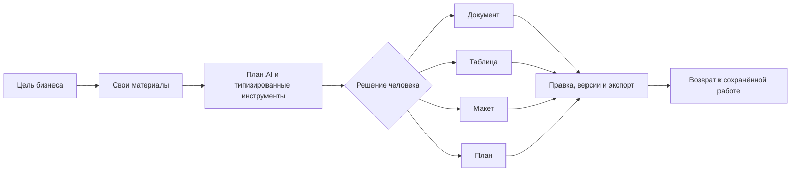
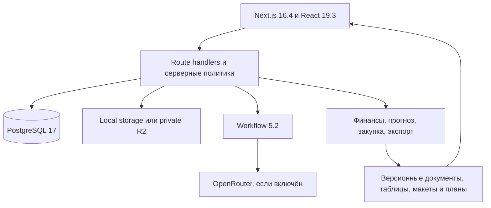

<p align="center">
  
</p>

<h1 align="center">Tirlik</h1>

<p align="center"><strong>Всё для вашего бизнеса</strong></p>

<p align="center"><a href="https://github.com/DarinaX2005X/digital-taraz-hackhathon">Репозиторий проекта</a></p>

<p align="center">
  
  
  
  
  
</p>

Tirlik помогает людям внутри бизнеса пройти путь от своих исходных материалов до решения и новых рабочих результатов. Пользователь описывает цель, добавляет прайс, документ, таблицу, изображение или шрифт, проверяет план и факты, выбирает вариант, затем получает редактируемые документы, таблицы, макеты и планы. Результаты сохраняются вместе с источниками, версиями и историей изменений.

AI участвует в рабочей сессии, но не заменяет предметные расчёты и решение человека. Ручное создание, загрузка файлов, редакторы, версии и экспорт работают без ключа AI. Покупателям компании не нужен аккаунт Tirlik: готовые материалы используются на сайте, в почте, мессенджере или другом привычном канале.


Иллюстрация создана для проекта и не является снимком интерфейса или доказательством результата. Её происхождение описано в [реестре публичных материалов](public/site/ASSETS.md).

## Что можно сделать

- Проверить нестандартный заказ по цене, сроку и доступной мощности, затем сохранить смету, предложение и план работ.
- Собрать финансовую модель с явными допущениями, отдельным движением денег и пересчётом сценариев.
- Построить прогноз только при достаточной истории, с исторической проверкой и сравнением с простой базовой моделью. При нехватке данных Tirlik сохраняет сценарный путь без выдуманного прогноза.
- Сопоставить предложения поставщиков с учётом единиц, упаковок, MOQ, доставки, налогов, валюты и срока, затем получить таблицу сравнения и неотправленный черновик заказа.
- Подготовить текст, редактируемый макет и план публикаций для кампании по своим товарам, ценам, фотографиям и стилю.
- Вернуться к проекту, исправить результат вручную, отменить действие, открыть сохранённую версию и выгрузить нужный формат.



## Живые результаты и контроль

Tirlik хранит не один текстовый ответ, а типизированные результаты с устойчивыми адресами элементов. Документ редактируется через Tiptap, таблица через Univer, макет через Fabric, план через предметный редактор. Команды проверяют версию, права, исходные данные, блокировки и хеш изменяемого элемента. Устаревшая правка получает конфликт вместо скрытой перезаписи.

История поддерживает ручные и согласованные AI-изменения. Восстановление старой версии создаёт новую ревизию. Экспорт фиксирует выбранные ревизии и проверяет доступ к связанным источникам перед скачиванием. Для конфиденциальных полей действует отдельная политика включения.

| Результат | Прямая работа | Экспорт |
| --- | --- | --- |
| Документ | текст, блоки, изображения, история | DOCX, PDF |
| Таблица | ячейки, формулы, несколько листов | XLSX, CSV |
| Макет | страницы, слои, изображения, шрифты | PNG, JPEG, PDF, редактируемый `.tirlik` |
| План | записи, ресурсы, сроки и решения | XLSX, PDF, ICS |

Каждая экспортная задача также может дать ZIP-пакет с манифестом и хешами файлов.

## Поддерживаемые исходники и границы

Один исходный файл занимает не больше 20 МБ. Сервер проверяет фактическую сигнатуру, ограничивает распаковку и не исполняет содержимое файла как инструкции.

| Класс | Форматы | Проверяемые границы |
| --- | --- | --- |
| Текст и данные | TXT, Markdown как текст, CSV, TSV | до 100 001 строки и 100 столбцов для CSV/TSV |
| Офисные файлы | XLSX, DOCX | до 20 000 строк на лист, 100 столбцов и 100 листов для XLSX |
| PDF | PDF | до 100 страниц; страницы без извлекаемого текста требуют отдельного распознавания |
| Изображения | PNG, JPEG, WebP | одно изображение, до 20 мегапикселей |
| Шрифты | TTF, OTF, WOFF | до 5 МБ на входе, встраивание только при подтверждённых правах |

Суммарный размер файлов одной экспортной задачи ограничен 100 МБ. Редактируемый пакет макета ограничен 60 МБ, один вложенный визуальный ресурс в нём занимает не больше 16 МБ.

## Быстрый локальный запуск

Нужны:

- Node.js `22.13` или новее в ветке `22.x`;
- npm `10` или новее;
- запущенные Docker Engine и Docker Compose;
- свободное место для зависимостей, PostgreSQL и пользовательских файлов.

Скопируйте пример окружения в `.env.local` и задайте новый случайный `BETTER_AUTH_SECRET`:

```powershell
Copy-Item .env.example .env.local
node --input-type=module -e "import { randomBytes } from 'node:crypto'; console.log(randomBytes(48).toString('base64url'))"
```

Вставьте полученное значение в `.env.local`. `OPENROUTER_API_KEY` можно оставить пустым. Затем выполните одну команду:

```powershell
node scripts/dev/start.mjs
```

Команда проверяет Node.js и Docker, при необходимости выполняет `npm ci` из lockfile, запускает принадлежащие этой копии PostgreSQL и Mailpit, применяет миграции, добавляет начальные данные и ждёт готовности приложения. В конце она печатает фактический локальный адрес и адрес Mailpit. Если порт приложения нужно задать явно:

```powershell
node scripts/dev/start.mjs --port 3100
```

Остановка сохраняет базу, файлы и workflow-состояние:

```powershell
node scripts/dev/stop.mjs
```

Повторный `start.mjs` открывает ту же работу. Полное описание локальных данных, production-режима и безопасной очистки находится в [руководстве по самостоятельному запуску](docs/product/self-hosting.md).

## Конфигурация

Секреты хранятся только на сервере и не должны попадать в Git, клиентский JavaScript, README или журналы. Базовый локальный шаблон находится в [.env.example](.env.example), а полный контракт локального и hosted режимов приведён ниже.

| Переменная | Назначение | Локальный режим |
| --- | --- | --- |
| `BETTER_AUTH_SECRET` | подпись сессий, уникальный случайный секрет | обязательна |
| `OPENROUTER_API_KEY` | доступ к AI-действиям через OpenRouter | необязательна для запуска и ручной работы |
| `TIRLIK_MODEL_AUTHORIZATION_LIMIT_USD` | верхняя граница активированной авторизации модели в данном окружении | необязательна; по умолчанию `10`, перед AI-активацией задайте долю этого окружения |
| `TIRLIK_STORAGE_DRIVER` | `local` или `r2` | отсутствующее значение вне Vercel означает `local` |
| `TIRLIK_DATA_DIR` | постоянные исходники и экспорты локального драйвера | по умолчанию `.local-data/files` |
| `SMTP_*` | письма восстановления и приглашений | локальный старт сам подключает Mailpit |
| `DATABASE_URL` | PostgreSQL | локальный старт сам задаёт URL своей Compose-базы |

Отсутствующий ключ OpenRouter переводит только AI-действие в понятное состояние недоступной модели. Уже сохранённые проекты, ручные редакторы, загрузка и экспорт остаются доступны.

Значение лимита должно быть положительной десятичной суммой без экспоненты. Нулевое, отрицательное или некорректное значение блокирует AI-действие как ошибку конфигурации. При активации создаётся серверная авторизация с этим пределом; уже действующую совместимую авторизацию можно только безопасно понизить, когда нет зарезервированной суммы и расход не превышает новый предел.

Текущий бюджет авторизации разделяется между окружениями, а не выдаётся каждому запуску заново. Для этой поставки предусмотрены 2 USD для локального окружения и 8 USD для размещённого окружения в рамках общего максимума 10 USD. Значение переменной не заменяет серверную активацию и запись расхода. Повторять вызов после неопределённого результата оплаты автоматически нельзя.

### Локальные файлы и R2

Самостоятельный запуск использует постоянный локальный каталог и не требует облачных ключей. Наличие R2-реквизитов само по себе не переключает драйвер.

Для Vercel принят отдельный контракт с приватным Cloudflare R2: `TIRLIK_STORAGE_DRIVER=r2` и полный набор `R2_ACCOUNT_ID`, `R2_BUCKET_NAME`, `R2_ACCESS_KEY_ID`, `R2_SECRET_ACCESS_KEY`. Частичный набор считается ошибкой конфигурации. Токену достаточно доступа Object Read & Write только к выбранному bucket. На Vercel локальный файловый fallback запрещён. Этот режим будет отмечен готовым только после завершённой проверки развёртывания и чтения сохранённых файлов; публичный адрес пока не заявлен.

## Архитектура



- PostgreSQL и Drizzle хранят аккаунты, права, проекты, версии, команды, источники, задания и чеки операций.
- Workflow выполняет устойчивые шаги, возобновление, отмену и контроль поздней записи.
- Предметные движки считают финансы, прогноз и закупку кодом. Модель выбирает и заполняет ограниченные типизированные инструменты.
- Tiptap, Univer и Fabric дают прямое редактирование соответствующего вида результата.
- ExcelJS, docx, PDFKit, resvg и Sharp производят реальные файлы для дальнейшей работы.

Подробнее: [архитектура и границы доверия](docs/product/architecture.md).

## Проверка поставки

Обычная проверка исходников:

```powershell
node scripts/check.mjs
node scripts/check-integration.mjs
node scripts/check-build.mjs
```

`check-integration.mjs` создаёт изолированные PostgreSQL, Mailpit, каталоги и порты для каждой фазы. Он не использует рабочие данные обычного запуска.

Независимая проверка чистой копии находится в `scripts/verify-clean-start.mjs`. Она копирует продукт без `node_modules`, сборочных кешей, `.env`, `.vibemachina` и Git-метаданных, проверяет воспроизводимую установку из lockfile даже при `NODE_ENV=production`, миграцию и локальный старт, затем через HTTP проверяет аккаунт, CSV-источник, ручную правку документа, реальные DOCX/PDF, отсутствие AI-ключа, остановку, повторный запуск и возврат к сохранённой работе. Запуск этой проверки долгий и требует свободного Docker-окна:

```powershell
node scripts/verify-clean-start.mjs
```

Скрипт выбирает отдельные порты и отдельный Compose project. Перед удалением он проверяет владельца контейнеров и volume. При ошибке временная копия и журнал сохраняются для разбора. Подробности: [чистая проверка](docs/product/clean-start.md).

Автоматические проверки подтверждают доменные правила, API, хранение и структуру экспортов. Они не подтверждают внешний вид страниц. Визуальное поведение, адаптивность и доступность требуют ручной проверки в обычном браузере.

## Production-сборка и размещение

Для локального production-режима сначала остановите принадлежащий приложению процесс, затем соберите и снова запустите его:

```powershell
node scripts/dev/stop.mjs
node scripts/check-build.mjs
node scripts/dev/start.mjs --mode production
```

Сборка хранится в `.local-data/build`. `check-build.mjs` удерживает startup lock и до изменения каталога сборки проверяет, что принадлежащий этой копии production-процесс подтверждённо остановлен. При активном или неоднозначном runtime команда завершается с `PRODUCTION_RUNTIME_ACTIVE`. Последовательность выше остаётся штатным способом обновления.

Vercel-развёртывание требует постоянный PostgreSQL, Workflow-конфигурацию, приватный R2, серверные auth/SMTP/AI-переменные и явный `BETTER_AUTH_URL`. Health-check без сохранения и чтения реального источника не считается готовым развёртыванием. Двухфазная [API-проверка размещения](docs/product/deployment-verification.md) создаёт 6,35-МБ источник, ручную правку и DOCX/PDF, а после нового deployment повторно открывает те же данные. Она не использует браузер и не делает платный AI-вызов без отдельного явного действия.

## Хранение и восстановление

Обычный `stop.mjs` сохраняет PostgreSQL volume, `.local-data/files` и `.local-data/workflow`. Сборки и кеши отделены от пользовательских данных. Перед резервным копированием или восстановлением остановите приложение:

```powershell
node scripts/dev/stop.mjs
node scripts/ops/local-data.mjs backup
node scripts/ops/local-data.mjs verify --from D:\tirlik-backups\before-update
node scripts/ops/local-data.mjs restore --from D:\tirlik-backups\before-update
```

Backup содержит PostgreSQL custom dump, файлы, workflow, список миграций, размеры и SHA-256, но не содержит секреты, логи, кеши или production-сборку. Restore ещё раз проверяет копию и сохраняет проверенный снимок текущего состояния в `.local-data/backups/pre-restore-*`. Существующие копии не перезаписываются и не удаляются автоматически. Полная процедура и действия при rollback-ошибке описаны в [руководстве по резервному копированию](docs/operations/local-backup.md).

## Языки, данные и приватность

Интерфейс и рабочие локали: русский, казахский и английский. Доступ к проекту определяется workspace, ролью и project scopes. Публичные страницы не открывают личные материалы. При включённом AI выбранные данные могут передаваться внешнему провайдеру, поэтому добавляйте только то, что вы вправе передавать для обработки.

Демонстрационные бизнес-материалы синтетические. Перед публичной работой с реальными персональными данными отдельно проверяются регион хранения, договоры провайдеров, резервное копирование, почта и политика удаления.

## Лицензии и материалы

В репозитории сейчас не объявлена лицензия на исходный код проекта. Наличие кода в публичном репозитории само по себе не даёт права на его использование вне условий правообладателя.

Лицензии зависимостей и дополнительные уведомления находятся в [THIRD-PARTY-NOTICES.md](THIRD-PARTY-NOTICES.md). Лицензии шрифтов и происхождение fixture-изображений лежат рядом с соответствующими файлами. Авторские публичные иллюстрации описаны в [public/site/ASSETS.md](public/site/ASSETS.md).

