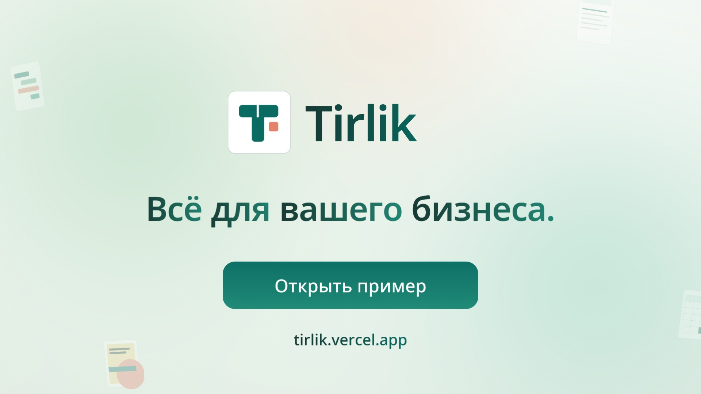
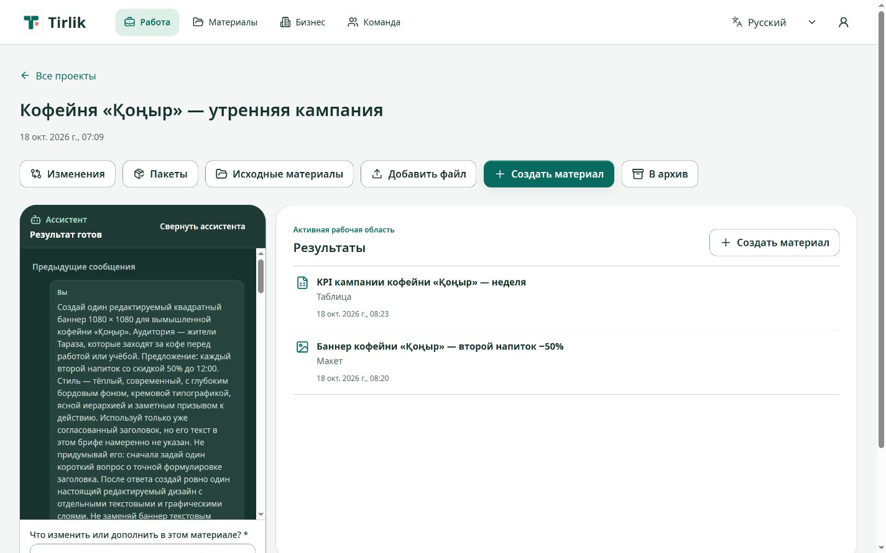
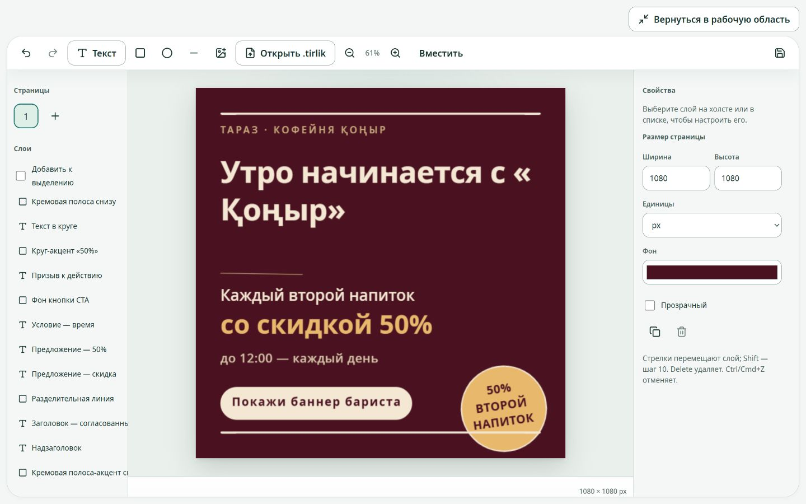
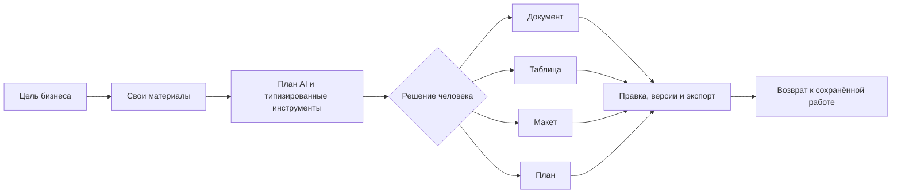
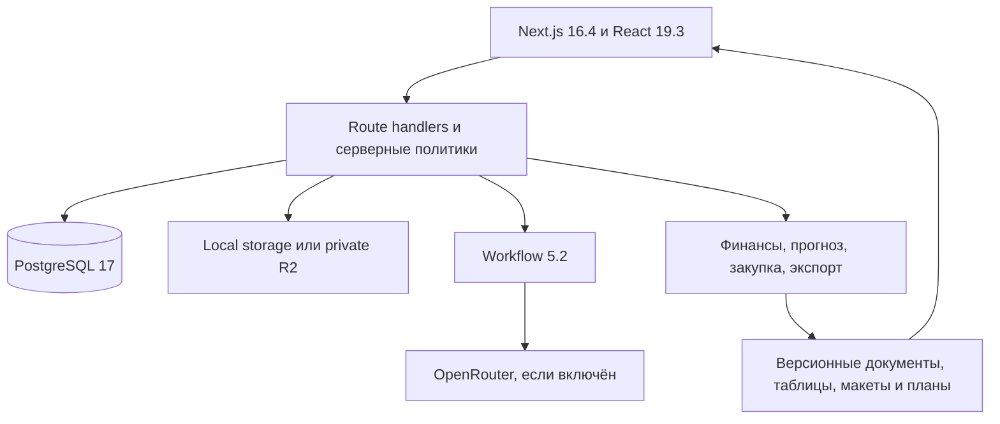

<p align="center">
  
</p>

<h1 align="center">Tirlik</h1>

<p align="center"><strong>Всё для вашего бизнеса</strong></p>

<p align="center">
  <a href="https://tirlik.vercel.app">Открыть Tirlik</a> ·
  <a href="https://tirlik.vercel.app/ru/demo">Попробовать рабочий пример</a> ·
  <a href="https://tirlik.vercel.app/video/tirlik-product-film-v2-ru.mp4">Смотреть видео</a> ·
  <a href="https://tirlik.vercel.app/presentation/tirlik-presentation.pdf">Открыть презентацию</a>
</p>

<p align="center">
  <a href="https://tirlik.vercel.app/presentation/tirlik-presentation.pptx">Редактируемая презентация</a> ·
  <a href="https://github.com/DarinaX2005X/digital-taraz-hackhathon">Исходный код</a>
</p>

<p align="center">
  
  
  
  
  
</p>

Tirlik помогает людям внутри бизнеса пройти путь от своих исходных материалов до решения и новых рабочих результатов. Пользователь описывает цель, добавляет прайс, документ, таблицу, изображение или шрифт, проверяет план и факты, выбирает вариант, затем получает редактируемые документы, таблицы, макеты и планы. Результаты сохраняются вместе с источниками, версиями и историей изменений.

При настроенном провайдере AI помогает составить план и подготовить изменения, но не заменяет предметные расчёты и решение человека. Ручное создание, загрузка файлов, редакторы, версии и экспорт работают без ключа AI. Покупателям компании не нужен аккаунт Tirlik: готовые материалы используются на сайте, в почте, мессенджере или другом привычном канале.

Публичный сайт и рабочий пример доступны без локальной установки. Пример открывает обычное рабочее пространство с заранее сохранёнными исходниками и результатами: в нём можно пройти те же страницы, редакторы и API-пути, не загружая свои данные. Полная самостоятельная копия запускается одной командой после настройки `.env.local` и сохраняет PostgreSQL, файлы и workflow-состояние между перезапусками.


Иллюстрация создана для проекта и не является снимком интерфейса или доказательством результата. Её происхождение описано в [реестре публичных материалов](public/site/ASSETS.md).

## Материалы для знакомства

[](https://tirlik.vercel.app/video/tirlik-product-film-v2-ru.mp4)

- [Рабочий пример](https://tirlik.vercel.app/ru/demo) открывает готовое пространство, где можно быстро посмотреть исходники, задачи, решения и редактируемые результаты.
- [Продуктовое видео Tirlik](public/video/tirlik-product-film-v2-ru.mp4) — русскоязычная анимация длительностью 104 секунды, 1920×1080, 60 fps, H.264/AAC. [Техническая справка о фильме](delivery/video/README.md) фиксирует параметры и происхождение файла.
- [Презентация в PDF](delivery/presentation/tirlik-presentation.pdf) показывает функции сайта и основные рабочие переходы.

## Примеры проектов



Проект собирает редактируемые материалы в одной рабочей области.



Баннер остаётся редактируемым: слои, размеры и оформление доступны прямо в макете.

## Что можно сделать

- Проверить нестандартный заказ по цене, сроку и доступной мощности, затем сохранить смету, предложение и план работ.
- Собрать финансовую модель с явными допущениями, отдельным движением денег и пересчётом сценариев.
- Построить прогноз только при достаточной истории, с исторической проверкой и сравнением с простой базовой моделью. При нехватке данных Tirlik сохраняет сценарный путь без выдуманного прогноза.
- Сопоставить предложения поставщиков с учётом единиц, упаковок, MOQ, доставки, налогов, валюты и срока, затем получить таблицу сравнения и неотправленный черновик заказа.
- Подготовить текст, редактируемый макет и план публикаций для кампании по своим товарам, ценам, фотографиям и стилю.
- Вернуться к проекту, исправить результат вручную, отменить действие, открыть сохранённую версию и выгрузить нужный формат.



## Живые результаты и контроль

Tirlik хранит не один текстовый ответ, а типизированные результаты с устойчивыми адресами элементов. Документ редактируется через Tiptap, таблица через Univer, макет через Fabric, план через предметный редактор. Команды проверяют версию, права, исходные данные, блокировки и хеш изменяемого элемента. Устаревшая правка получает конфликт вместо скрытой перезаписи.

История поддерживает ручные и согласованные AI-изменения. Восстановление старой версии создаёт новую ревизию. Экспорт фиксирует выбранные ревизии и проверяет доступ к связанным источникам перед скачиванием. Для конфиденциальных полей действует отдельная политика включения.

| Результат | Прямая работа | Экспорт |
| --- | --- | --- |
| Документ | текст, блоки, изображения, история | DOCX, PDF |
| Таблица | ячейки, формулы, несколько листов | XLSX, CSV |
| Макет | страницы, слои, изображения, шрифты | PNG, JPEG, PDF, редактируемый `.tirlik` |
| План | записи, ресурсы, сроки и решения | XLSX, PDF, ICS |

Каждая экспортная задача также может дать ZIP-пакет с манифестом и хешами файлов.

## Поддерживаемые исходники и границы

Один исходный файл занимает не больше 20 МБ. Сервер проверяет фактическую сигнатуру, ограничивает распаковку и не исполняет содержимое файла как инструкции.

| Класс | Форматы | Проверяемые границы |
| --- | --- | --- |
| Текст и данные | TXT, Markdown как текст, CSV, TSV | до 100 001 строки и 100 столбцов для CSV/TSV |
| Офисные файлы | XLSX, DOCX | до 20 000 строк на лист, 100 столбцов и 100 листов для XLSX |
| PDF | PDF | до 100 страниц; страницы без извлекаемого текста требуют отдельного распознавания |
| Изображения | PNG, JPEG, WebP | одно изображение, до 20 мегапикселей |
| Шрифты | TTF, OTF, WOFF | до 5 МБ на входе, встраивание только при подтверждённых правах |

Суммарный размер файлов одной экспортной задачи ограничен 100 МБ. Редактируемый пакет макета ограничен 60 МБ, один вложенный визуальный ресурс в нём занимает не больше 16 МБ.

## Самостоятельный запуск

Нужны:

- Node.js `>=22.13.0 <23`;
- npm `10` или новее;
- запущенные Docker Engine и Docker Compose;
- доступные loopback-порты для приложения, PostgreSQL, SMTP и Mailpit;
- свободное место для зависимостей, PostgreSQL и пользовательских файлов.

Скопируйте пример окружения в `.env.local` и задайте новый случайный `BETTER_AUTH_SECRET`:

```powershell
Copy-Item .env.example .env.local
node --input-type=module -e "import { randomBytes } from 'node:crypto'; console.log(randomBytes(48).toString('base64url'))"
```

Вставьте полученное значение в `.env.local`. `OPENROUTER_API_KEY` можно оставить пустым. Затем выполните одну команду:

```powershell
node scripts/dev/start.mjs
```

Команда проверяет Node.js и Docker, при необходимости выполняет `npm ci` из lockfile, запускает принадлежащие этой копии PostgreSQL 17 и Mailpit, применяет миграции, добавляет начальные данные и ждёт готовности приложения. В конце она печатает фактический локальный адрес и адрес Mailpit. По умолчанию launcher предпочитает порты `3000`, `54329`, `10259` и `8029`; при первом запуске занятый порт заменяется свободным и сохраняется для этой копии. Если порт приложения нужно задать явно:

```powershell
node scripts/dev/start.mjs --port 3100
```

Остановка сохраняет базу, файлы и workflow-состояние:

```powershell
node scripts/dev/stop.mjs
```

Повторный `start.mjs` открывает ту же работу. `stop.mjs` обращается к приватному control endpoint сохранённого supervisor и не завершает произвольный процесс только по номеру PID. PostgreSQL volume, пользовательские файлы, workflow и Mailpit остаются на месте.

## Конфигурация

Секреты хранятся только на сервере и не должны попадать в Git, клиентский JavaScript, README или журналы. Базовый локальный шаблон находится в [.env.example](.env.example), а полный контракт локального и hosted режимов приведён ниже.

| Переменная | Назначение | Локальный режим |
| --- | --- | --- |
| `BETTER_AUTH_SECRET` | подпись сессий, уникальный случайный секрет | обязательна |
| `OPENROUTER_API_KEY`, `OPENROUTER_MODEL` | доступ к AI-действиям и выбранная модель OpenRouter | необязательны для запуска и ручной работы |
| `TIRLIK_MODEL_AUTHORIZATION_LIMIT_USD` | верхняя граница активированной авторизации модели в данном окружении | необязательна; по умолчанию `10`, перед AI-активацией задайте долю этого окружения |
| `TIRLIK_STORAGE_DRIVER` | `local` или `r2` | отсутствующее значение вне Vercel означает `local` |
| `TIRLIK_DATA_DIR` | постоянные исходники и экспорты локального драйвера | по умолчанию `.local-data/files` |
| `BETTER_AUTH_URL` | внешний origin приложения для auth callback | локальный шаблон использует `http://127.0.0.1:3000` |
| `SMTP_HOST`, `SMTP_PORT`, `SMTP_FROM`, `SMTP_USER`, `SMTP_PASSWORD`, `SMTP_REQUIRE_TLS` | письма восстановления и приглашений | локальный старт сам подключает Mailpit; внешние реквизиты не нужны |
| `DATABASE_URL` | PostgreSQL | локальный старт сам задаёт URL своей Compose-базы |

Отсутствующий ключ OpenRouter переводит только AI-действие в понятное состояние недоступной модели. Уже сохранённые проекты, ручные редакторы, загрузка и экспорт остаются доступны.

Значение лимита должно быть положительной десятичной суммой без экспоненты. Нулевое, отрицательное или некорректное значение блокирует AI-действие как ошибку конфигурации. При активации создаётся серверная авторизация с этим пределом; уже действующую совместимую авторизацию можно только безопасно понизить, когда нет зарезервированной суммы и расход не превышает новый предел.

Бюджет авторизации задаётся отдельно для каждого окружения, а не выдаётся каждому запуску заново. Значение переменной не заменяет серверную активацию и запись расхода. Повторять вызов после неопределённого результата оплаты автоматически нельзя.

### Локальные файлы и R2

Самостоятельный запуск использует постоянный локальный каталог и не требует облачных ключей. Наличие R2-реквизитов само по себе не переключает драйвер.

| Путь или volume | Содержимое | Можно пересоздать без потери работы |
| --- | --- | --- |
| `tirlik-<checkout>_postgres-data` | аккаунты, проекты, права, версии, команды и задания | нет |
| `.local-data/files` | исходники, изображения, шрифты и экспорты | нет |
| `.local-data/workflow` | устойчивое состояние выполняемых и возобновляемых задач | нет |
| `.local-data/dev` | identity процесса, состояние supervisor и локальные журналы | только штатными dev-командами |
| `.local-data/build` | проверенная production-сборка | да, когда production-процесс остановлен |
| `.next`, `.swc`, `node_modules` | кеши и зависимости из lockfile | да, после остановки; следующий запуск восстановит нужное |

Не удаляйте `.local-data` для очистки кеша или уменьшения размера проекта: там находятся база, пользовательские файлы и незавершённая работа. Штатная остановка ничего из этой области не удаляет.

Для Vercel принят отдельный контракт с приватным Cloudflare R2: `TIRLIK_STORAGE_DRIVER=r2` и полный набор `R2_ACCOUNT_ID`, `R2_BUCKET_NAME`, `R2_ACCESS_KEY_ID`, `R2_SECRET_ACCESS_KEY`. Частичный набор считается ошибкой конфигурации. Токену достаточно доступа Object Read & Write только к выбранному bucket. На Vercel локальный файловый fallback запрещён. Публичная версия находится по адресу [tirlik.vercel.app](https://tirlik.vercel.app); готовность конкретного deployment проверяется отдельным сохранением и повторным чтением данных, а не только ответом health-check.

В публичной версии подтверждены загрузка исходников в приватный R2 и их повторное открытие. AI подготовил редактируемый баннер, а выбранная правка сохранилась как новая ревизия того же результата. Облачный экспорт DOCX/PDF после последних исправлений ещё требует отдельной проверки. Проверка повторяющейся задачи пока не завершена: таблица сохранена, а создание плана остановилось по таймауту. Полный ручной путь с экспортом доступен при самостоятельном локальном запуске.

## Архитектура



- PostgreSQL и Drizzle хранят аккаунты, права, проекты, версии, команды, источники, задания и чеки операций.
- Workflow выполняет устойчивые шаги, возобновление, отмену и контроль поздней записи.
- Предметные движки считают финансы, прогноз и закупку кодом. Модель выбирает и заполняет ограниченные типизированные инструменты.
- Tiptap, Univer и Fabric дают прямое редактирование соответствующего вида результата.
- ExcelJS, docx, PDFKit, resvg и Sharp производят реальные файлы для дальнейшей работы.

Подробнее: [архитектура и границы доверия](docs/product/architecture.md).

## Проверка поставки

Обычная проверка исходников:

```powershell
node scripts/check.mjs
node scripts/check-integration.mjs
node scripts/check-build.mjs
```

`check-integration.mjs` создаёт изолированные PostgreSQL, Mailpit, каталоги и порты для каждой фазы. Он не использует рабочие данные обычного запуска.

Независимая проверка чистой копии находится в `scripts/verify-clean-start.mjs`. Она копирует продукт без `node_modules`, сборочных кешей, `.env`, `.vibemachina` и Git-метаданных, проверяет воспроизводимую установку из lockfile даже при `NODE_ENV=production`, миграцию и локальный старт, затем через HTTP проверяет аккаунт, CSV-источник, ручную правку документа, реальные DOCX/PDF, отсутствие AI-ключа, остановку, повторный запуск и возврат к сохранённой работе. Запуск этой проверки долгий и требует свободного Docker-окна:

```powershell
node scripts/verify-clean-start.mjs
```

Скрипт выбирает отдельные порты и отдельный Compose project. Перед удалением он проверяет владельца контейнеров и volume. При ошибке временная копия и журнал сохраняются для разбора. Подробности: [чистая проверка](docs/product/clean-start.md).

Автоматические проверки подтверждают доменные правила, API, хранение и структуру экспортов. Они не подтверждают внешний вид страниц. Визуальное поведение, адаптивность и доступность требуют ручной проверки в обычном браузере.

## Обновление, production-сборка и размещение

Перед обновлением production-копии остановите принадлежащий приложению процесс и сохраните резервную копию. После замены исходников на нужную версию соберите и снова запустите приложение:

```powershell
node scripts/dev/stop.mjs
node scripts/ops/local-data.mjs backup
node scripts/check-build.mjs
node scripts/dev/start.mjs --mode production
```

Launcher сверяет lockfile, поэтому после изменения зависимостей следующая установка выполняется через `npm ci`. Миграции применяются при старте и не требуют ручной команды. Сборка хранится в `.local-data/build`. `check-build.mjs` удерживает startup lock и до изменения каталога сборки проверяет, что принадлежащий этой копии production-процесс подтверждённо остановлен. При активном или неоднозначном runtime команда завершается с `PRODUCTION_RUNTIME_ACTIVE`.

Vercel-развёртывание требует постоянный PostgreSQL, Workflow-конфигурацию, приватный R2, серверные auth/SMTP/AI-переменные и явный `BETTER_AUTH_URL`. Health-check без сохранения и чтения реального источника не считается готовым развёртыванием. Двухфазная [API-проверка размещения](docs/product/deployment-verification.md) создаёт 6,35-МБ источник, ручную правку и DOCX/PDF, а после нового deployment повторно открывает те же данные. Она не использует браузер и не делает платный AI-вызов без отдельного явного действия.

## Хранение и восстановление

Обычный `stop.mjs` сохраняет PostgreSQL volume, `.local-data/files` и `.local-data/workflow`. Сборки и кеши отделены от пользовательских данных. Перед резервным копированием или восстановлением остановите приложение:

```powershell
node scripts/dev/stop.mjs
node scripts/ops/local-data.mjs backup
node scripts/ops/local-data.mjs verify --from D:\tirlik-backups\before-update
node scripts/ops/local-data.mjs restore --from D:\tirlik-backups\before-update
```

По умолчанию backup создаётся в `.local-data/backups/`. Он содержит PostgreSQL custom dump, файлы, workflow, список миграций, размеры и SHA-256, но не содержит секреты, логи, кеши или production-сборку. `verify` проверяет копию без восстановления. `restore` ещё раз проверяет её, сохраняет снимок текущего состояния в `.local-data/backups/pre-restore-*`, а затем восстанавливает базу и каталоги. Существующие копии не перезаписываются и не удаляются автоматически. Для хранения вне сервера скопируйте готовый каталог backup в отдельное защищённое место. Действия при rollback-ошибке описаны в [расширенном руководстве по резервному копированию](docs/operations/local-backup.md).

### Диагностика self-hosted запуска

- `APP_ALREADY_RUNNING`: остановите эту копию перед сменой режима или явного порта.
- `DEPENDENCIES_CHANGED`: остановите приложение и запустите снова, чтобы launcher установил зависимости из текущего lockfile.
- `DOCKER_UNAVAILABLE`: запустите Docker Engine и повторите команду.
- `DATABASE_NOT_LOCAL_COMPOSE`: удалите внешний `DATABASE_URL` из локального окружения.
- `DATA_DIRECTORY_OUTSIDE_LOCAL_ROOT`: верните `TIRLIK_DATA_DIR` внутрь `.local-data` этой копии.
- `PRODUCTION_RUNTIME_ACTIVE`: штатно остановите production-процесс перед сборкой.
- Если после аварийного завершения остался startup lock, а записанный процесс уже не существует, выполните `node scripts/dev/stop.mjs --recover-lock` и затем повторите запуск.

Дополнительные детали о runtime identity, R2 CORS и восстановлении после ошибок собраны в [технической справке self-hosting](docs/product/self-hosting.md); для обычной установки и обновления достаточно инструкций в этом README.

## Языки, данные и приватность

Интерфейс и рабочие локали: русский, казахский и английский. Доступ к проекту определяется workspace, ролью и project scopes. Публичные страницы не открывают личные материалы. При включённом AI выбранные данные могут передаваться внешнему провайдеру, поэтому добавляйте только то, что вы вправе передавать для обработки.

Демонстрационные бизнес-материалы синтетические. Перед публичной работой с реальными персональными данными отдельно проверяются регион хранения, договоры провайдеров, резервное копирование, почта и политика удаления.

## Лицензии и материалы

В репозитории сейчас не объявлена лицензия на исходный код проекта. Наличие кода в публичном репозитории само по себе не даёт права на его использование вне условий правообладателя.

Лицензии зависимостей и дополнительные уведомления находятся в [THIRD-PARTY-NOTICES.md](THIRD-PARTY-NOTICES.md). Лицензии шрифтов и происхождение fixture-изображений лежат рядом с соответствующими файлами. Авторские публичные иллюстрации описаны в [public/site/ASSETS.md](public/site/ASSETS.md).

