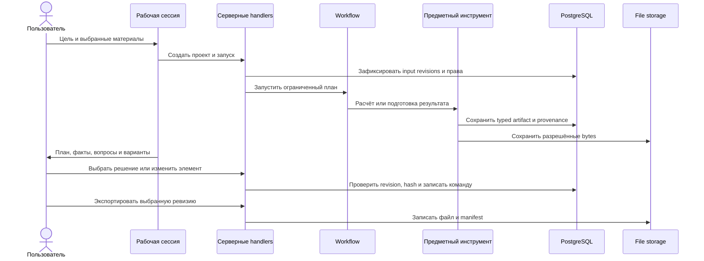

# Архитектура Tirlik

Tirlik соединяет свободную деловую цель с ограниченными предметными инструментами и версионными рабочими результатами. Модель не получает прямой путь к базе или произвольному JSON. Она вызывает зарегистрированные операции, а сервер повторно проверяет права, версии, входные ссылки, лимиты и структуру результата.

## Основной поток

## Границы компонентов

| Слой | Ответственность |
| --- | --- |
| Next.js App Router | страницы, route handlers, server rendering, локали |
| Identity | сессии, workspace membership, project scopes, версии авторизации |
| Sources | ограниченная загрузка, сигнатуры, разбор, версии, provenance, OCR-review |
| Runs | план, события, resume/cancel, лимиты, budget ledger, поздняя запись |
| Agent tools | типизированные бизнес-операции без произвольного доступа к данным |
| Artifacts | документы, таблицы, макеты, планы, команды, версии, locks, bindings |
| Domain engines | точные финансы, прогноз, закупка, расписание и проверяемые выводы |
| Exports | фиксированные ревизии, реальные форматы, private download, manifest |
| Storage | постоянные bytes в локальном каталоге или приватном R2 |

## Модель согласованности

Каждый исходник и результат имеет неизменяемую версию и текущую ревизию. Команда содержит базовую ревизию, хеш адресованного элемента и ожидаемые ревизии источников. Сервер проверяет их в транзакции. Один согласованный набор изменений применяет все дочерние команды вместе или не применяет ни одной.

Ручная правка и AI-правка используют один командный путь. Undo опирается на сохранённую обратную операцию, а restore создаёт следующую ревизию. Экспорт фиксирует vector выбранных ревизий, поэтому последующая правка не изменяет уже подготовленный файл.

## Доверие и внешние сервисы

- Пользователь выбирает исходники и подтверждает деловое решение.
- Код считает детерминированные значения и проверяет форматы.
- Модель используется только при наличии ключа, активированной серверной авторизации и доступного бюджета.
- Исходный файл считается недоверенными данными, его текст не становится инструкцией для модели или сервера.
- OpenRouter, SMTP, управляемый PostgreSQL и R2 являются внешними обработчиками для соответствующего развёртывания.
- Секреты остаются на сервере. Переменные без префикса `NEXT_PUBLIC_` не должны попадать в клиентскую сборку.

## Масштабирование

Тяжёлые данные ограничены по размеру, страницы и списки имеют курсоры, а разбор CSV пишет куски с backpressure. Состояние workflow вынесено из процесса приложения. Для нескольких server instances нужны общие PostgreSQL, storage и Workflow world, а также согласованные секреты Next.js Server Actions и deployment ID. Один локальный self-hosted instance использует собственные Docker volume и каталоги checkout.

